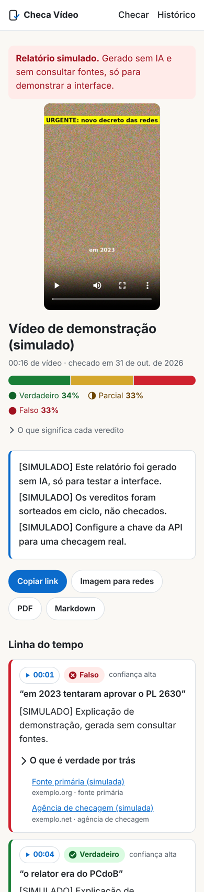
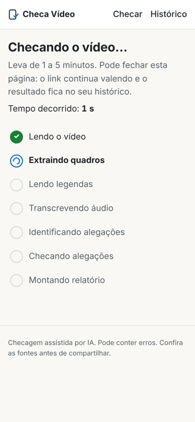

# Checa Vídeo

Recebeu um vídeo no WhatsApp ou no Instagram e ficou na dúvida? O Checa Vídeo recebe o **arquivo**
do vídeo (Reels, TikTok, Shorts, Kwai), lê tudo o que é dito e mostrado nele, separa as alegações
factuais, checa cada uma em fontes confiáveis e devolve um relatório com veredito por alegação,
linha do tempo, porcentagens e fontes.

<p>
  
  
</p>

> As capturas acima são de um **relatório simulado** (vídeo sintético, IA desligada), gerado só
> para mostrar a interface. Há também a [versão de computador](docs/relatorio-desktop.png) e o
> [card para redes](docs/card-exemplo.png).

---

## Sumário

- [Como rodar](#como-rodar)
- [Arquitetura](#arquitetura)
- [Pipeline](#pipeline)
- [Decisões tomadas](#decisões-tomadas)
- [Custo por checagem (medido)](#custo-por-checagem-medido)
- [Como trocar modelos](#como-trocar-modelos)
- [Como adicionar um idioma](#como-adicionar-um-idioma)
- [Testes](#testes)
- [Regras editoriais](#regras-editoriais)
- [Limitações conhecidas](#limitações-conhecidas)
- [Perguntas em aberto](#perguntas-em-aberto)

---

## Como rodar

### Com Docker (recomendado)

```bash
make dev        # cria .env a partir do .env.example (se faltar) e sobe redis, api, worker e web
```

Abra http://localhost:3000. Antes, preencha `ANTHROPIC_API_KEY` no `.env`. Para só ver a
interface sem chave, use `LLM_PROVEDOR=simulado` (os vereditos saem sorteados e marcados como
simulados).

O modelo do Whisper (~1,5 GB para `medium`) é baixado na primeira checagem e fica no volume
`modelos`. Para embutir na imagem: `WHISPER_PRELOAD=medium make dev`.

### Sem Docker

Precisa de Python 3.12, Node 22, `ffmpeg` e `tesseract-ocr` com os pacotes `por` e `eng`.

```bash
pip install -e "backend[dev]"
make local      # API com fila em thread (sem Redis) + Next em modo dev
make demo       # igual, mas com IA simulada e Whisper desligado (não precisa de chave)
```

Para o modo de produção da fila sem Docker: `redis-server`, `FILA=rq uvicorn checa.api.main:app`
e `python -m checa.worker`, todos dentro de `backend/`.

---

## Arquitetura

```
 navegador ──► web (Next.js, SSR) ──/api/*──► api (FastAPI) ──► Redis ──► worker (RQ)
                 │  proxy em streaming         │  upload, SHA-256,          │  ffmpeg, tesseract,
                 │  (mesma origem, cookie)     │  status, exportações       │  faster-whisper,
                 │                             │                            │  API da Anthropic
                 └──────────────────────────── SQLite + arquivos (volume /dados) ◄─┘
```

| Peça | Escolha | Onde |
|---|---|---|
| Backend | Python 3.12, FastAPI | `backend/checa/api/` |
| Fila | RQ + Redis (`FILA=inline` roda numa thread, para dev/testes) | `backend/checa/fila.py`, `worker.py` |
| Banco | SQLite via SQLModel (`DATABASE_URL` aceita Postgres) | `backend/checa/db.py` |
| Arquivos | Disco local, atrás de uma interface com implementação S3 | `backend/checa/storage.py` |
| Frontend | Next.js 15 (App Router), TypeScript, CSS próprio | `web/` |
| IA | Messages API da Anthropic: visão, web search, web fetch | `backend/checa/llm/`, `prompts/` |

Estrutura:

```
prompts/                 system prompts versionados (extract, verify, synthesize + regras editoriais)
backend/checa/
  media/                 probe.py (ffprobe, hash), frames.py (contact sheets), ocr.py, audio.py
  transcricao.py         fala + legenda + tela numa linha do tempo, com divergências
  etapas/                extrair.py, verificar.py, sintetizar.py (as 3 chamadas ao modelo)
  llm/                   cliente (Anthropic e simulado), esquemas, parser de JSON, custos, prompts
  pipeline.py            orquestração, progresso, orçamento, cache, moderação
  relatorio.py           contagem, porcentagens, fontes consolidadas, Markdown
  exportar.py            card 1080×1350 e PDF
  api/                   FastAPI + rate limit
backend/tests/           unitários, ponta a ponta, API, aceitação (casos A e B) e gabaritos
web/                     Next.js: upload, progresso, relatório, histórico, proxy /api/*
fixtures/                onde ficam os vídeos reais dos testes de aceitação (fora do git)
```

A chave da API só existe nos contêineres `api` e `worker`. O navegador fala apenas com o Next,
que repassa `/api/*` ao backend.

---

## Pipeline

| Etapa (como aparece na tela) | O que faz |
|---|---|
| **Lendo o vídeo** | `ffprobe`: duração, resolução, fps, áudio. Rejeita > 10 min. O SHA-256 do arquivo deduplica: mesmo vídeo = mesmo relatório (com botão "checar de novo"). |
| **Extraindo quadros** | Contact sheets 4×3 com o tempo queimado (`fps=1/2`, ou `1/3` acima de 3 min; `scale=300`, `drawtext %{pts\:hms}`, `tile=4x3`). Quadros em alta só quando o modelo pede (ferramenta `ver_quadro`, até 3). |
| **Lendo legendas** | Detecta a faixa da legenda, o modo (palavra por palavra ou bloco) e roda o OCR com a máscara de quase-branco. Também lê textos de tela fora da faixa. Guarda o OCR cru para auditoria. |
| **Transcrevendo áudio** | faster-whisper (`medium`, `pt`), com tempo por palavra e VAD. Detecta vídeo sem áudio, mudo ou só com música. |
| **Identificando alegações** | Chamada 1 (`MODEL_EXTRACT`): transcrição unificada + mosaicos → descrição, tese central, alegações em JSON. |
| **Checando alegação k de N** | Chamada 2 (`MODEL_VERIFY`), uma por alegação checável, com web search (`max_uses` 6) e web fetch; até 3 ao mesmo tempo (`VERIFICACAO_PARALELA`). |
| **Montando relatório** | Contagem no código; chamada 3 (`MODEL_SYNTHESIZE`) para resumo, acertos, padrão e limitações. |

### OCR de legenda (o que aprendemos na checagem manual)

1. **Faixa detectada, não fixa.** Para cada linha horizontal da metade de baixo do quadro, conta
   quantas vezes a máscara de quase-branco "liga" ao longo da linha. Texto tem muitas transições
   (cada traço de letra); chapéu ou camiseta branca têm duas. A faixa é a que tem esse pico de
   forma persistente numa amostra de até 40 quadros.
2. **Modo.** 20 quadros a 4 fps (em até 3 janelas com legenda): se o texto troca por texto mais
   de 1 vez por segundo, é palavra por palavra (OCR a 4 fps); senão, bloco (1 fps).
3. **Máscara.** Recorte da faixa, ampliação 2×, `min(R,G,B) > 225`, remoção de pontinhos
   isolados (componentes pequenos), inversão, `MedianFilter(3)`, borda branca de 30 px. Quadros
   com menos de 150 px de máscara = sem legenda.
4. **Tesseract** `-l por --psm 7` (uma linha) ou `--psm 6` (duas linhas, contadas pela projeção
   horizontal da máscara), 1 thread por processo, vários processos em paralelo.
5. **Limpeza e reconstrução.** Descarta linhas de ruído, deduplica, e na legenda cumulativa
   ("te impedir" → "te impedir de" → "te impedir de falar") fica com a versão mais longa,
   ancorando a comparação no começo da frase para tolerar erro de OCR na última palavra. No modo
   bloco, fica com a leitura mais "central" de cada grupo.

### Transcrição unificada

O áudio é a fonte principal da fala; a legenda confirma (cobertura de palavras de conteúdo ≥ 60 %)
ou diverge (< 35 %). Divergência vira `divergencia: true`, aparece destacada na transcrição do
relatório com os dois textos e é registrada nas limitações. Texto de tela é uma camada separada.

### Garantias que não dependem do modelo obedecer

- **Fonte só se foi aberta.** Toda URL citada no veredito é comparada com as URLs que de fato
  vieram nos resultados de web search/web fetch. As outras são descartadas, e o relatório diz
  quantas foram.
- **Duas fontes independentes** (domínios diferentes) para "verdadeiro" ou "falso"; com menos,
  a confiança cai para "média" no máximo e o card da alegação explica por quê.
- **Números calculados no código.** Contagem, porcentagens (método do maior resto, somam 100) e
  a frase "somando falso e enganoso, X %…" não passam pelo modelo.
- **JSON validado** com Pydantic; se vier inválido, o erro volta ao modelo (anexado ao histórico)
  e ele reenvia, até 2 vezes.

---

## Decisões tomadas

| Tema | Decisão | Por quê |
|---|---|---|
| Nome | Mantive **Checa Vídeo** | Diz o que faz, em português, curto. |
| Frontend | **Next.js** (App Router) | SSR pronto (o relatório funciona sem JS), proxy de streaming em route handler, ecossistema conhecido. |
| Fila | **RQ + Redis** | Mais simples que Celery para um único tipo de job. `FILA=inline` dispensa Redis em dev. |
| Upload | Navegador → Next (`/api/*`) → FastAPI, em streaming | Mesma origem: cookie de sessão sem CORS, chave só no backend, sem limite de corpo do Next. |
| Sem JS | Formulário de upload funciona sem JS (o backend redireciona); progresso se atualiza com `<meta refresh>`; timestamps viram links `#t=` | Pedido do spec (leitura sem JS) estendido ao fluxo todo. |
| Paleta | Verde/amarelo/laranja/vermelho/cinza com tons escuros para texto (AA) e ícone próprio por veredito | O veredito nunca depende só da cor. "Sem fonte" tem hachura na barra. |
| Faixa da legenda | Procurada da metade do quadro para baixo (`OCR_BUSCA_FAIXA_INICIO=0.45`), não só no terço inferior | Legendas automáticas do CapCut/TikTok ficam muitas vezes entre 50 % e 65 % da altura. O falso positivo que o terço inferior evitava (chapéu, roupa branca) é tratado pela contagem de transições. **Desvio do spec.** |
| Regra dos 40 % | Aplicada a linhas com 3+ palavras; linhas de 1–2 palavras precisam de uma palavra com 3+ letras | Na legenda cumulativa, "o decreto" (50 % de tokens de 1 caractere) é o começo legítimo de uma frase. |
| Texto de tela | OCR em faixas de texto encontradas em máscaras binárias (branco, amarelo, preto), não no quadro inteiro com `--psm 6` | No quadro inteiro com fundo texturizado o tesseract levava mais de 60 s por quadro. As máscaras pegam manchetes, títulos e faixas e rodam em ~1 s por vídeo curto. **Desvio do spec.** |
| Cache | (1) mesmo vídeo = mesmo relatório (SHA-256); (2) OCR, áudio e mosaicos guardados por vídeo, reaproveitados em "checar de novo"; (3) **veredito reaproveitado** para a mesma alegação (mesmo texto normalizado, modelo e versão do prompt) por 7 dias | As buscas rodam no servidor da Anthropic e não dá para guardar o resultado delas; o que dá para guardar é o veredito. Vídeos virais voltam reencodados (outro hash) com as mesmas frases. |
| Vídeo sem legenda e sem fala | Segue com o texto de tela e os mosaicos; as limitações dizem isso | Um vídeo só com texto na tela ainda tem alegações. |
| Áudio indisponível | Se o modelo do Whisper não carregar, a checagem continua com legenda e tela e registra a limitação | Melhor um relatório com limitação explícita do que nenhum. |
| Orçamento | Teto por checagem (`ORCAMENTO_USD_POR_CHECAGEM`, padrão **US$ 1**). As alegações são checadas da mais importante para a menos; antes de iniciar cada uma, o custo estimado das que estão em andamento fica reservado; ao chegar no teto, as restantes ficam "não verificadas" e saem das porcentagens | O spec pede para perguntar antes de passar de US$ 1 (veja o custo abaixo). Na primeira rodada paralela vale a estimativa inicial (US$ 0,25, acima da média medida); um custo real bem maior pode passar do teto em até uma rodada. |
| Checagem em paralelo | 3 alegações ao mesmo tempo | Cada checagem com Opus leva ~35 s; em sequência, 15 alegações passariam de 9 min (o spec fala em 1–5 min). |
| Web fetch recusado | O cliente repete sem web fetch e mantém a busca e os fallbacks | Aconteceu de verdade no teste (rede restrita). Recursos opcionais saem um de cada vez, e um 400 não é cobrado. |
| Recusas | `fallbacks: "default"` (reexecuta no modelo indicado pela Anthropic quando há recusa por política) | Evita falha da checagem por falso positivo do classificador. Desligue com `FALLBACKS=`. |
| Structured outputs | Na extração e na síntese; na checagem (que usa busca) o JSON é pedido no prompt e validado | Se a API recusar algum recurso opcional, o cliente repete sem ele. |
| "Onde você viu" | Guardado no banco, **não** enviado ao modelo | É só registro, e é texto livre do usuário. |
| Login | Sem login; histórico por cookie de sessão | Primeiro corte. Login entra quando houver necessidade de ver o histórico em outro aparelho. |
| Moderação | Política mínima: se a extração marcar conteúdo ilegal, o arquivo, os artefatos e o registro do vídeo são apagados e o usuário vê uma mensagem genérica | Pedido do spec. Decisões além disso estão em [Perguntas em aberto](#perguntas-em-aberto). |

---

## Custo por checagem (medido)

Medido em 01/11/2026 com a API real, num vídeo sintético de 31 s com 10 frases do caso B na
legenda (12 alegações, 10 checáveis), sem áudio. No ambiente de teste a API recusou o web fetch
("sandbox with restricted network access"); a checagem rodou só com web search.

| | Opus 5.5 na checagem | Sonnet 5.5 na checagem |
|---|---|---|
| Extração (Sonnet 5.5, transcrição + mosaicos) | US$ 0,04 | US$ 0,04 |
| Checagem, 10 alegações | **US$ 1,72** (US$ 0,17 por alegação) | **US$ 0,86** (US$ 0,09 por alegação) |
| Síntese (Opus 5.5) | US$ 0,06 | US$ 0,06 |
| **Total** | **US$ 1,82** | **US$ 0,96** |
| Buscas por alegação | 5,6 | 4,1 |
| Fontes por alegação no relatório | 5,2 | 2,9 |
| Tempo total (checagem em sequência) | 7,5 min | 4,5 min |
| Alegações-chave do gabarito B acertadas | 7 de 8 (8 de 8 com o ajuste de prompt abaixo) | 6 de 8 |

**Onde vai o dinheiro** (checagem com Opus): buscas 33 %, saída (raciocínio + resposta) 31 %,
gravação em cache dos resultados de busca 27 %, leitura de cache 7 %, entrada 2 %. Os mosaicos de
imagem e o reconhecimento de voz pesam quase nada: os mosaicos custam centavos na extração e o
Whisper e o OCR rodam no servidor, sem cobrança por uso.

**Projeção para os vídeos reais** (mesmo custo por alegação):

| Vídeo | Alegações checáveis | Opus na checagem | Sonnet na checagem |
|---|---|---|---|
| Caso A (Lenin, 90 s) | 12 | ~US$ 2,15 | ~US$ 1,15 |
| Caso B (decretos, 179 s) | 15 | ~US$ 2,70 | ~US$ 1,40 |

Com o web fetch liberado (produção), cada página lida soma até ~8 mil tokens; em compensação, o
modelo tende a buscar menos. Isso ainda não foi medido.

**Qualidade, Opus × Sonnet, no mesmo vídeo:** o Sonnet errou "sem nenhum direito de defesa"
(deu "parcial"; o gabarito é "falso"), achou metade das fontes e, na alegação "o PT recorreu ao
STF", concluiu "falso" por não achar o PT nos autos, sem identificar quem recorreu. O Opus nomeou
Facebook e Google e os números dos recursos. Os dois deixaram de citar, em "falou que o Lula é
ladrão, derrubam", que crimes contra a honra seguem exigindo ordem judicial. Depois disso, o
prompt de checagem ganhou uma instrução geral sobre "regras com exceções", e o Opus passou a
citar essa salvaguarda (teste isolado, US$ 0,22).

**Teto padrão de US$ 1.** Como o custo medido com Opus passa de US$ 1, o padrão continua sendo um
teto de US$ 1 por checagem até haver decisão (ver [Perguntas em aberto](#perguntas-em-aberto)).
Com ele, só as ~4 alegações mais importantes são verificadas e as outras aparecem como
"não verificadas". Cada relatório guarda o uso real (tokens, buscas e US$ por etapa) em
`relatorio.custo`.

O que mais reduz custo, em ordem: trocar `MODEL_VERIFY` para Sonnet (metade do custo, com perda
de qualidade visível acima); baixar `WEB_SEARCH_MAX_USES` (as buscas são um terço do custo no
Opus e metade no Sonnet); agrupar alegações do mesmo assunto numa chamada só (ainda não
implementado; no caso B, várias alegações dependem do mesmo decreto); o cache de vereditos (já
ligado) para vídeos repetidos.

---

## Como trocar modelos

Tudo por variável de ambiente (`.env`), sem mudar código:

```bash
MODEL_EXTRACT=claude-sonnet-5-5      # limpar OCR, segmentar alegações, ver os mosaicos
MODEL_VERIFY=claude-opus-5-5         # checagem com busca
MODEL_SYNTHESIZE=claude-opus-5-5     # resumo e padrão
EFFORT_VERIFY=medium                 # low | medium | high | xhigh | max
```

O modelo de checagem entra na chave do cache de vereditos, então trocar de modelo não reaproveita
vereditos antigos. Para um modelo fora da tabela de `backend/checa/llm/custos.py`, acrescente o
preço lá (senão o custo é estimado com o preço do Opus).

---

## Como adicionar um idioma

1. **OCR:** instale o pacote do tesseract (`tesseract-ocr-spa`, por exemplo) no
   `backend/Dockerfile` e defina `TESSERACT_IDIOMA=spa` (ou `por+spa`).
2. **Áudio:** `WHISPER_IDIOMA=es`.
3. **Prompts:** copie `prompts/` para uma pasta nova (ex.: `prompts/es/`), traduza os 4 arquivos e
   aponte `PROMPTS_DIR` para ela. As regras editoriais e as definições dos vereditos vivem lá.
4. **Definições dos vereditos e textos do relatório:** `backend/checa/relatorio.py` (`VEREDITOS`,
   `AVISO`, Markdown) e `backend/checa/exportar.py` (PDF e card). A interface lê as definições da
   API.
5. **Interface:** os textos estão nos componentes de `web/components` e `web/app`. Para mais de um
   idioma ao mesmo tempo, o próximo passo é extrair esses textos para um dicionário.

---

## Testes

```bash
make test-backend   # 64 testes + 2 de aceitação (pulados sem chave e vídeos); precisa de ffmpeg e tesseract-ocr-por
make test-web       # checagem de tipos + build do Next
make aceitacao      # casos reais A e B (custam dinheiro; veja fixtures/README.md)
```

O que está coberto:

- **OCR:** máscara, remoção de pontos, inversão e borda, contagem de linhas, limpeza, dedupe,
  reconstrução cumulativa (inclusive com erro de OCR, piscada e janela deslizante), agrupamento
  em bloco, detecção de faixa com chapéu e camiseta brancos, taxa de mudança palavra × bloco.
- **Regressão do caso B:** quadro sintético com texto branco sobre ruído bege. O teste exige que o
  OCR cru **erre** e que o OCR com máscara leia exatamente "te impedir de falar".
- **Merge áudio/legenda:** confere, diverge, sem áudio, ordenação das camadas.
- **Parser JSON e retry:** JSON puro, cercado, com texto em volta, malformado, fora do formato;
  retry que anexa o erro ao histórico; desistência depois das tentativas.
- **Regras de fonte:** URLs não abertas descartadas; duas fontes independentes.
- **Cliente Anthropic:** o SDK real contra um servidor local de SSE (betas, fallbacks,
  output_config, web search, uso e fontes; reenvio quando um recurso opcional é recusado).
- **Ponta a ponta:** vídeo sintético de 10 s gerado por ffmpeg com legenda palavra por palavra e
  título; OCR real; IA e Whisper simulados; relatório completo; divergência legenda × fala;
  moderação que apaga tudo.
- **API:** upload, deduplicação, "checar de novo", exportações, vídeo com Range (206), histórico
  por cookie, formulário sem JS, arquivo inválido, vídeo longo, rate limit por IP.
- **Aceitação:** gabaritos dos casos A e B em `backend/tests/gabaritos/`, com o comparador
  (±1 alegação, veredito igual ou adjacente) testado à parte.

---

## Regras editoriais

Estão nos prompts (`prompts/regras_editoriais.md`, incluídas nas 3 chamadas):

1. **Mesmo rigor para qualquer lado.** O veredito é sobre o fato. Nenhuma frase pode revelar
   simpatia política. Trocar os nomes dos atores políticos não deveria mudar a estrutura do
   veredito.
2. **Separar fato de opinião**, sempre. Opinião não recebe "falso".
3. **Mostrar o que é verdade.** Alegação parcial, enganosa ou falsa tem "o que é verdade por trás"
   quando existir base real.
4. **Nunca inventar fonte.** Só URLs efetivamente abertas pela busca (e o código confere).
5. **Sem adjetivos sobre o autor** nem especulação sobre intenção.
6. **Pessoas privadas:** foco no conteúdo; nada de perfil ou dados pessoais.
7. **Incerteza explícita:** confiança alta/média/baixa visível; OCR ou áudio ruins são ditos.
8. **Linguagem:** português do Brasil, direto, frases curtas, sem "vale lembrar que".
9. **Citações protegidas:** sem letras de música ou trechos longos; citar e linkar.

---

## Limitações conhecidas

- **Casos A e B ainda não rodados com os vídeos reais** (os arquivos não estavam no ambiente). Uma
  checagem real foi feita num vídeo sintético com as frases do caso B (ver o custo medido acima);
  os testes de aceitação estão prontos para os vídeos reais.
- **Tempo com checagem em paralelo não foi medido** com a API real (só com o cliente simulado).
- **Whisper não foi medido** neste ambiente (o download do modelo estava bloqueado). Estimativa
  para `medium` em CPU de 4 núcleos com int8: na casa de 0,5× a 1× a duração do vídeo. `large-v3`
  em CPU deve ficar de 3 a 4 vezes mais lento; com GPU (`WHISPER_DISPOSITIVO=cuda`,
  `WHISPER_COMPUTE_TYPE=float16`) fica bem abaixo da duração do vídeo.
- **Imagem Docker do backend não foi construída aqui:** a rede do ambiente bloqueia os pacotes do
  Debian. O `docker-compose.yml` foi validado (`docker compose config`), a imagem do frontend foi
  construída e testada, e os mesmos componentes do backend rodaram fora do Docker (inclusive
  Redis + worker RQ).
- **OCR:** legendas coloridas (amarelas, com contorno grosso colorido) não entram na máscara de
  quase-branco da faixa; só no OCR de tela. Texto muito pequeno ou em movimento pode falhar.
- **SQLite** com API e worker no mesmo volume funciona para um servidor; para vários workers em
  máquinas diferentes, use Postgres (`DATABASE_URL`) e S3 (`ARMAZENAMENTO=s3`, experimental, sem
  testes automatizados).
- **Migrações:** as tabelas são criadas na inicialização; ainda não há Alembic.
- **Favicons das fontes** vêm do serviço de ícones do DuckDuckGo (requisição externa feita pelo
  navegador do leitor).
- **Retenção:** os vídeos ficam guardados para o player do relatório; ainda não há rotina de
  limpeza por idade.

---

## Perguntas em aberto

Decisões que o spec pede para confirmar antes:

1. **Custo acima de US$ 1.** Medido: ~US$ 0,17 por alegação com Opus na checagem (vídeo do caso B
   ≈ US$ 2,70) e ~US$ 0,09 com Sonnet (≈ US$ 1,40), com qualidade pior no Sonnet. Hoje o teto
   padrão é US$ 1, o que deixa boa parte das alegações sem verificar. Caminhos: (a) subir o teto
   para ~US$ 3 e manter Opus; (b) Sonnet na checagem com teto de ~US$ 1,50; (c) implementar o
   agrupamento de alegações do mesmo assunto numa chamada só, que deve trazer o Opus para perto de
   US$ 1.
2. **Moderação além do mínimo.** Hoje: rejeitar e não armazenar quando a extração marca conteúdo
   ilegal. Em aberto: guardar o hash de vídeos rejeitados para bloquear reenvio, usar um serviço de
   detecção por hash (exige conta em terceiros) e definir o procedimento de notificação às
   autoridades.
